# Kilowattlas · Home Assistant integration

**Building the measurement foundation for energy sharing in Sweden.** This integration
shares what your [Energy dashboard](https://www.home-assistant.io/docs/energy/)
measures with [Kilowattlas](https://kilowattlas.com), and is being built as the
base for **energy communities** (*energigemenskaper*) and **community virtual
power plants** (cVPP). Households in Sweden may share electricity with each
other from 1 January 2027.

Today it puts your home on the public live map of Swedish home energy. Every
reading of the Energy dashboard's power sensors (grid, solar, battery, home
and individual devices) is sent as soon as it is measured, in the Energy
dashboard's own sign. If you know the Energy dashboard, you already know how
to set this up.

**[Installation guide, step by step with pictures →](#install-and-set-up)**

[](https://my.home-assistant.io/redirect/marketplace_repository/?owner=SmilingSweetSwede&repository=kilowattlas-homeassistant&category=integration)

> [!TIP]
> **Help shape energy communities in Sweden.** Households may share electricity
> from 1 January 2027. We are building the tools for it, and want to hear what you
> need: **[join the discussion](https://github.com/SmilingSweetSwede/kilowattlas-homeassistant/discussions/1)**.

## Where this is heading

Kilowattlas is a public map today. This integration is meant to become the
measurement foundation for **energy communities** (Swedish *energigemenskaper*)
and **community virtual power plants** (cVPP) in Sweden. From 1 January 2027
households in the same bidding zone may share electricity with each other
([prop. 2025/26:240](https://www.riksdagen.se/sv/dokument-och-lagar/dokument/proposition/nya-lagar-om-elsystemet_hd03240/html/)).
A cVPP is a virtual power plant owned by its members, selling flexibility to
[Svenska kraftnät](https://www.svk.se/aktorsportalen/bidra-med-reserver/) or
the grid operator, with the proceeds going back to the households
([what a cVPP is](https://vb.nweurope.eu/projects/project-search/cvpp-community-based-virtual-power-plant/)).
Kilowattlas measures, counts and organises. It never controls your equipment.

Nothing changes for you today: only what is described under *Privacy* is
shared. Any community feature will be a separate opt-in on kilowattlas.com.
Overview and tester sign-up: https://kilowattlas.com/energigemenskap

*På svenska:* integrationen är tänkt som mätgrund för energigemenskaper och
medlemsägda virtuella kraftverk (cVPP). Energidelning blir laglig 1 januari
2027. Inget ändras för dig i dag; framtida funktioner är ett separat val på
kilowattlas.com.

## Requirements

- Home Assistant 2026.10 or newer, and a Kilowattlas account.
- Power sensors in the Energy dashboard: **Settings → Dashboards → Energy**,
  the power fields of your grid, solar, battery, home and individual devices.
  Without them, you can enter the same fields in this integration instead.

## Install and set up

Kilowattlas is in the
[Marketplace](https://www.home-assistant.io/integrations/marketplace/), which
is built into Home Assistant from 2026.11. Setting it up takes a few minutes
and needs an administrator account in Home Assistant.

### 1. Install from the Marketplace

[](https://my.home-assistant.io/redirect/marketplace_repository/?owner=SmilingSweetSwede&repository=kilowattlas-homeassistant&category=integration)

The button opens Kilowattlas in your Marketplace; continue from step 4. If your
Home Assistant does not open, change the address on the page that appears to
your own (for example `http://homeassistant.local:8123`). Without the button:

1. Go to **Settings → Marketplace**.
2. The first time, the Marketplace explains that what you install is made by
   the community. Tick **I understand the risks and agree** and select
   **Continue**.
3. Search for **Kilowattlas** and open it.
4. Select **Install**. No restart is needed: the setup opens by itself.

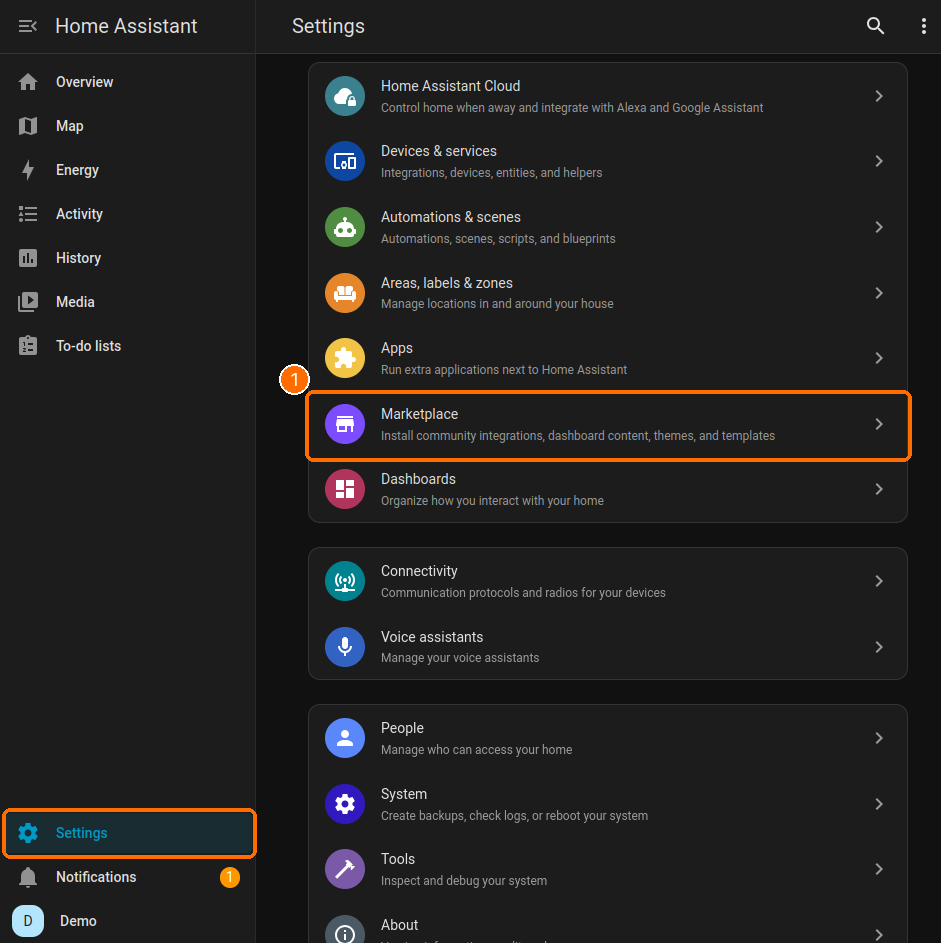

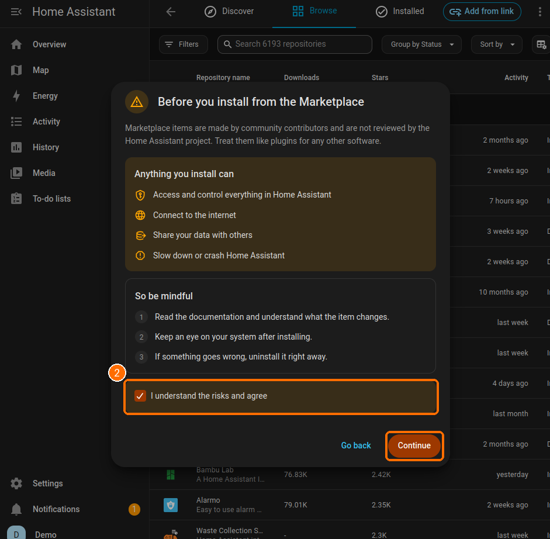

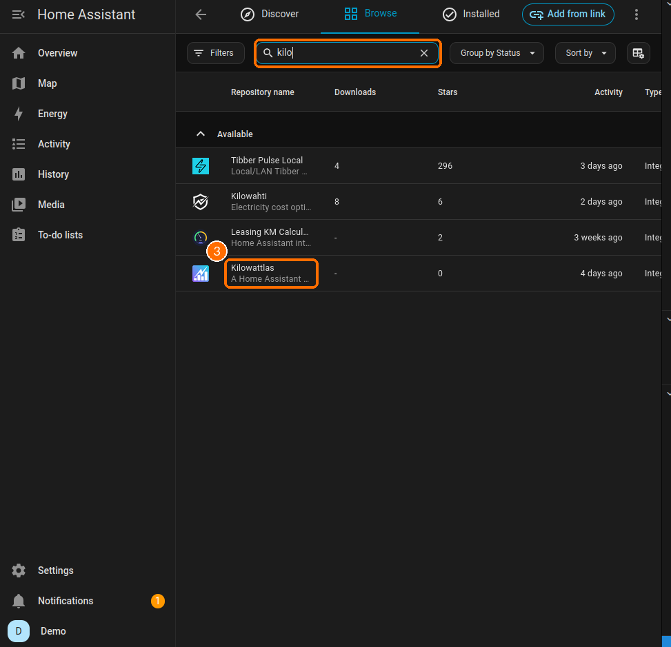

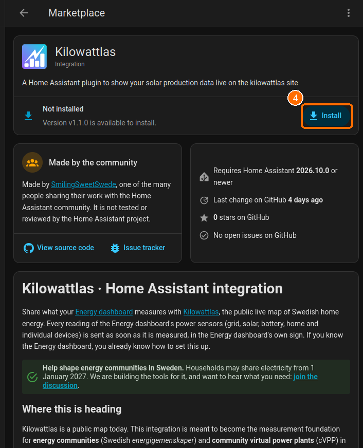

### 2. Connect to Kilowattlas

[](https://my.home-assistant.io/redirect/config_flow_start/?domain=kilowattlas)

1. The setup opens by itself after the install. If you closed it, select
   **Set up** on Kilowattlas' page in the Marketplace, or go to **Settings →
   Devices & services → Add integration → Kilowattlas**.
2. Read what is shared, turn on the toggle to agree, and select **Submit**.
3. Open the link Home Assistant shows, to `kilowattlas.com/link`, and sign in
   or create an account. Choose which installation it is (one you added on
   the map, or a new one), give it a name (shown publicly, so not your
   address), check the position prefilled from Home Assistant, add the peak
   power in kW, tick that you accept, and select **Approve link**. Home
   Assistant continues by itself.
4. Untick any Energy sensor you do not want to share, and select **Submit**.
   Change it later under **Configure**. Sensors you add to the Energy
   dashboard later are shared too.
5. Optionally choose an area for the device, and select **Skip and finish**.

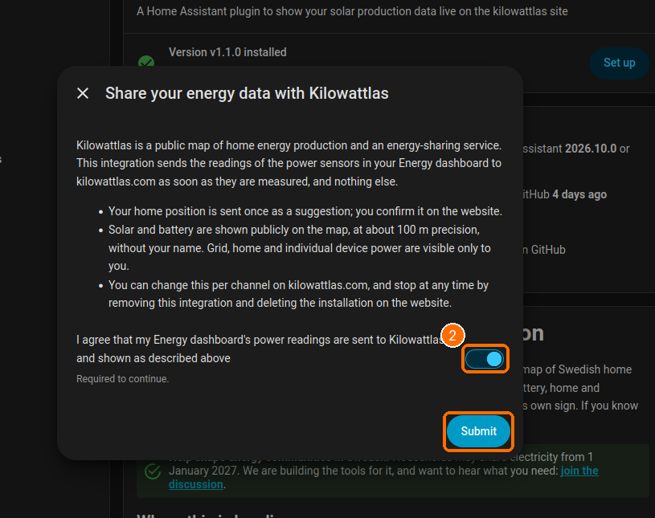

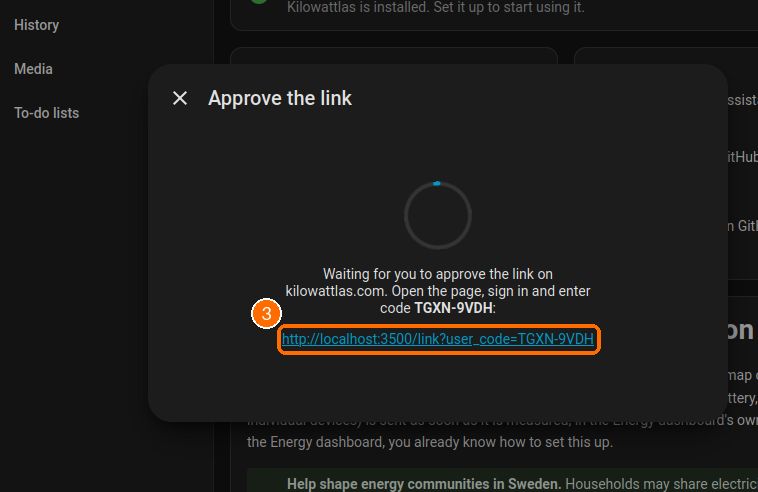

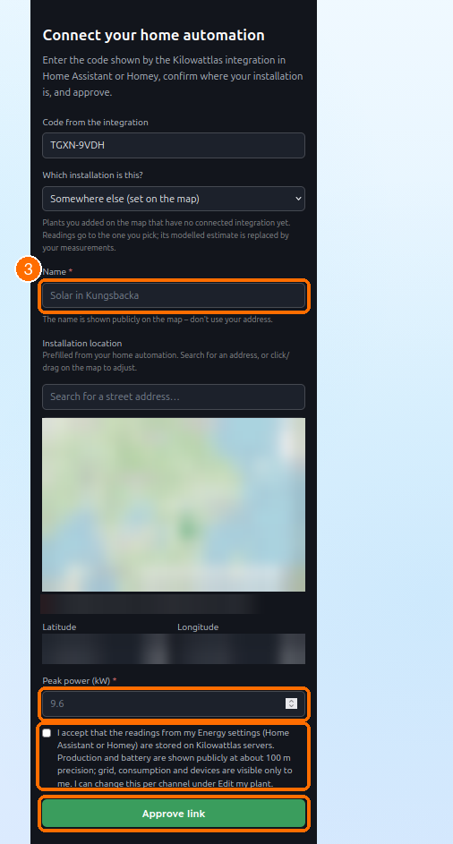

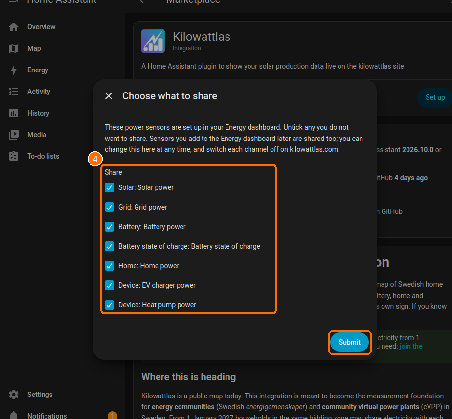

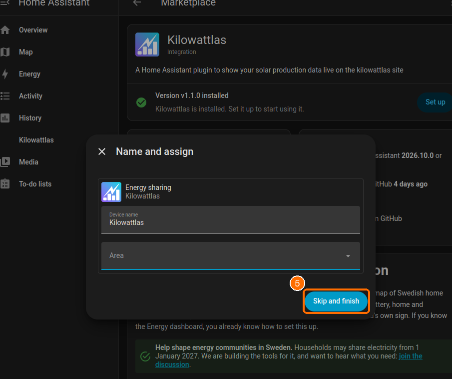

Then check that readings arrive: see *See that it works* below.

### Updates

The Marketplace shows new versions as an update under **Settings → Updates**,
like Home Assistant's own updates. Install it, and restart if Home Assistant
asks you to.

### Home Assistant 2026.10

The Marketplace is built in from 2026.11. On 2026.10, Kilowattlas is in
[HACS](https://www.hacs.xyz/) under the same name: search for it there,
install, restart and continue from step 2. When you update Home Assistant to
2026.11, the Marketplace takes over the installation and keeps updating it.

### Without the Marketplace

Copy `custom_components/kilowattlas` from the
[latest release](https://github.com/SmilingSweetSwede/kilowattlas-homeassistant/releases/latest)
into the `custom_components` folder of your Home Assistant configuration,
restart and continue from step 2. You then update by hand.

### Remove

Remove the integration under **Settings → Devices & services → Kilowattlas →
⋮ → Delete**. This revokes its token. Then uninstall it in the Marketplace,
and delete the installation on kilowattlas.com to erase its history (see
*Privacy*).

## See that it works

**Kilowattlas** in the sidebar (administrators) shows whether this home is
connected, every channel with the sensor it reads, the last value sent and when,
and a tick box to stop or resume sending it.

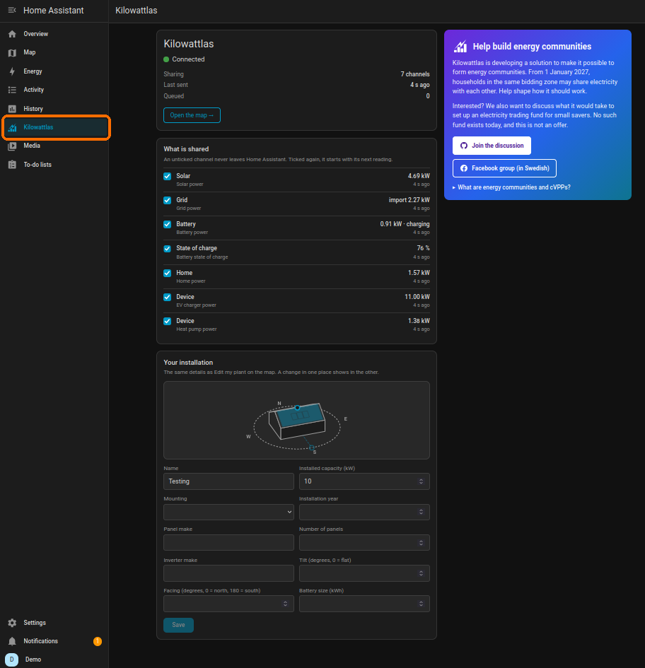

Your installation also shows on [kilowattlas.com](https://kilowattlas.com),
with what is public and, only to you, the rest:

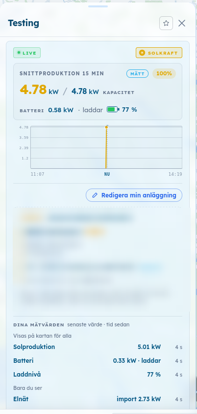

The same status is available as a card for your own dashboards. The Energy
dashboard itself is generated by Home Assistant and takes no cards from
integrations.

## Built on the Energy dashboard

| Energy dashboard field | Shared as | Shown |
|---|---|---|
| Grid power (positive = import) | grid | only to you |
| Solar power | production | on the map |
| Battery power (positive = discharge), state of charge, capacity | battery | on the map |
| Home power | consumption | only to you |
| Individual device power | one channel per device, with its name | only to you |

Inverted sensors and separate import/export sensors are handled by the Energy
dashboard's own power settings; this integration reads what the Energy
dashboard reads. Without Energy settings, the integration's own form asks for
the same fields and uses the Energy dashboard's own code for them.

**CheckWatt** ([ha-checkwatt](https://github.com/faanskit/ha-checkwatt) 0.3.0)
has no power sensors yet; solar, battery and grid power are attributes (W) of
its *Battery SoC* sensor. Until it does, add template sensors and pick them in
the Energy dashboard:

```yaml
template:
  - sensor:
      - name: "CheckWatt solar power"
        unique_id: checkwatt_solar_power
        unit_of_measurement: W
        device_class: power
        state_class: measurement
        state: "{{ state_attr('sensor.checkwatt_battery_soc', 'solar_power') | float(0) }}"
      # Same for battery_power and grid_power.
```

## Privacy

Sent: your home position once at linking (you confirm it on the website), each
reading of the shared sensors with its timestamp, the battery capacity, and a
revoke request when you remove the integration. Nothing else leaves Home
Assistant. Shown publicly, at about 100 m, without name or account: production
and battery. Only to you: grid, home and devices. Each channel can be set to
public, only you, or off on kilowattlas.com, and a channel not set to public
appears on no public page or API. Grid is private by default because public
solar, grid and battery together give away your consumption. The service is
free and does not sell your data.

To stop: remove the integration (revokes the token), then delete the
installation on kilowattlas.com (erases its history).

## Limitations

Measurements only: no control of any device and no market bidding. Prices are
added server-side; nothing is read from `nordpool`. Readings Home Assistant
could not send are sent later from its recorder, for up to 10 days.

## Development

API client: [aiokilowattlas](https://github.com/SmilingSweetSwede/aiokilowattlas)
(MIT). `custom_components/kilowattlas/energy_source.py` holds the mapping from
the Energy dashboard's model, with references to core.

```bash
# Python 3.14 test harness in Docker (Home Assistant 2026.3+ needs 3.14.2+)
docker run --rm -v "$PWD/.venv-docker-314:/venv" -v "$PWD:/repo" -w /repo python:3.14 \
  bash -c "/venv/bin/pytest --cov=custom_components.kilowattlas"
python3 scripts/build_translations.py   # regenerate translations/en.json
python3 scripts/check_shipped_source.py  # before a release: see below
```

What the Marketplace installs is plain source kept in this repository: the status page
and the house drawing are hand-written custom elements with Home Assistant's
theme variables, with no framework and no build step, as Home Assistant
custom integrations are expected to be. Nothing under `custom_components/` is
built from, or depends on, any other repository. `scripts/check_shipped_source.py`
enforces this in CI and fails on bundles, build headers, frameworks and
references to sibling checkouts.

Release order: the backend accepts every kind the release declares first (an
unknown kind rejects the whole batch), then aiokilowattlas, then this
integration. `KILOWATTLAS_API_BASE` and `KILOWATTLAS_MAP_BASE` point the API
client and the Visit link at a local stack.
